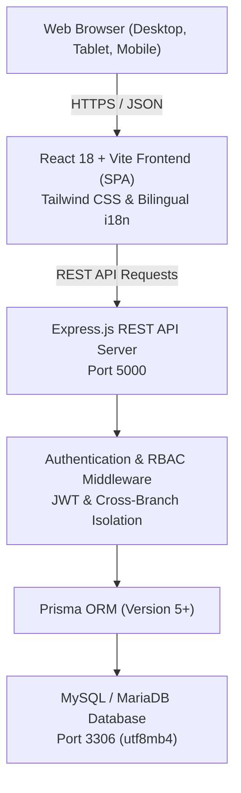

# System Architecture & Technical Specifications

## 1. System Overview
**Smart School Fee** is a secure, multi-tenant school fee management web application architected for private schools in Ethiopia. It provides administrative controls, bilingual user experience (English and Amharic), Ethiopian Birr (ETB) monetary management, fine-grained Role-Based Access Control (RBAC), sequential identifier generation, and an immutable audit trail.

---

## 2. Architecture Diagram

---

## 3. Technology Stack
- **Frontend**: React 18, Vite, React Router v6, Tailwind CSS, Lucide Icons.
- **Backend**: Node.js v22, Express v4, Zod schema validation, Helmet, CORS, Morgan logger, express-rate-limit.
- **Database & ORM**: MySQL / MariaDB (Port 3306), Prisma ORM with native `Decimal(12,2)` precision for financial computations.
- **Security**: Bcrypt password hashing (12 salt rounds), JSON Web Tokens (access + refresh token pattern), strict tenant isolation, SQL injection prevention via Prisma parameterization, CSRF/XSS mitigations.
- **Localization**: English and Amharic (Ethiopic Unicode typography), Ethiopian Birr (ETB) format (`ETB 1,250.00`).

---

## 4. Multi-Tenant Role-Based Access Control (RBAC)

The system supports 7 distinct hierarchical and operational roles:

| Role | Scope | Key Capabilities |
| :--- | :--- | :--- |
| **SUPER_ADMIN** | Platform / Multi-School | Full system control, school onboarding, cross-school administration, global audit logs. |
| **SCHOOL_ADMIN** | School-wide | Academic years, terms, grades, fee structures, branch management, staff accounts. |
| **BRANCH_ADMIN** | Assigned Branch | Branch student registration, class sections, branch fee reports, cashier oversight. |
| **REGISTRAR** | Assigned Branch/School | Student enrollments, guardian records, class section transfers, student profiles. |
| **CASHIER** | Assigned Branch | Record full & partial payments, issue receipts, view outstanding student balances. |
| **ACCOUNTANT** | Assigned Branch/School | Financial reports, fee collection reconciliation, audit log review, payment reversal requests. |
| **VIEWER** | Read-only | View permitted records without modification capabilities. |

---

## 5. Financial Safety & Transactional Integrity
1. **Decimal Precision**: All monetary values are strictly typed as `Decimal(12, 2)` to eliminate JavaScript floating-point errors.
2. **Safe Identifier Generation**: Student IDs (`AF-0001`), Invoices (`INV-2026-0001`), and Receipts (`REC-2026-0001`) use atomic database sequential counters within transactions to guarantee uniqueness even under concurrent requests.
3. **Idempotency Protection**: Payment submissions include idempotency tokens to prevent duplicate charging during network retries or double clicks.
4. **Non-Destructive Financial History**: Financial invoices and payments are never hard deleted; payments are adjusted or reversed through audited reversal records.
